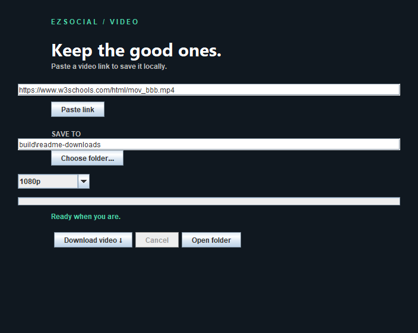
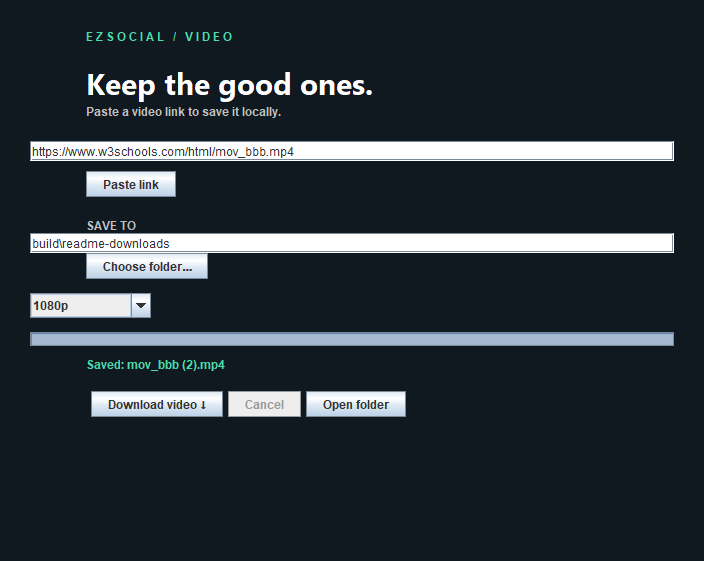

# EZDownload

Save videos from a link on Windows or Android. Paste a URL into the app, send a page from Chrome or Edge, or use Android's share menu. Downloads run on your device and save as MP4.

The app is called **EzSocial Video** on Android and **EzSocialToVideo** in Windows filenames.



## Using the app

### Windows

Extract `EzSocialToVideo-Windows.zip`, then open `dist\EzSocialToVideo\EzSocialToVideo.exe` inside the extracted folder. Keep the `app` and `runtime` folders beside the executable; Java is included.

1. Paste a video URL, or click **Paste link**.
2. Choose where to save it and select **720p**, **1080p**, or **Best**.
3. Click **Download video**. Progress and the saved filename appear in the window.

**Open folder** opens your destination in Explorer. Downloads sent through the browser extension reveal the saved file automatically.

<details>
<summary>After a download</summary>



Both screenshots show the running Windows app, using the [W3Schools sample video](https://www.w3schools.com/html/mov_bbb.mp4).

</details>

### Chrome and Edge

The extension adds a toolbar button and a **Download with EzSocial** link context-menu action. Its icon shows progress, then a green check or an error indicator.

1. Open `chrome://extensions` or `edge://extensions` and enable **Developer mode**.
2. Choose **Load unpacked** and select `browser-extension` from the extracted ZIP or source checkout.
3. Copy the extension ID and run this from the same ZIP or checkout root:

   ```powershell
   powershell -ExecutionPolicy Bypass -File .\scripts\Register-Browser.ps1 -ExtensionId YOUR_EXTENSION_ID
   ```

4. Pin **Send to EzSocial** and click it on a video page.

Registration connects that extension ID to the local app through browser native messaging. Run it again if you move the app. Reload the extension after updating it, once any active downloads have finished. To remove the integration, run `scripts\Unregister-Browser.ps1` and remove the extension.

### Android

Install `EzSocialToVideo-Android.apk` on Android 10 or newer. Open **EzSocial Video** once and allow notifications.

Share a video link from another app, open the Android share menu if needed, and choose **Save video with EzSocial**. You can also paste links into the launcher app. A notification shows progress; finished videos appear in your gallery under **Movies/EzSocial**. Tap the completion notification to open the video.

Downloads queue one at a time. Cancel stops the current queue. If Android stops the app, share the link again. Leave space for temporary files as well as the final gallery copy.

## Which links work?

| Source | Support |
| --- | --- |
| YouTube | MP4 streams via NewPipe Extractor. Separate audio and video tracks are joined without transcoding. |
| Instagram | Public posts and reels, with anonymous-query and page metadata fallbacks. Carousels use the first available video. |
| TikTok | Public page metadata and short-link redirects. Extraction is best effort. |
| Other sites | Direct MP4 URLs and pages exposing compatible video metadata or HTML video sources. |

Quality is a ceiling: the app picks from the streams the source provides. Private or login-gated videos, DRM, livestreams, HLS-only sources, age restrictions, and anti-bot checks may prevent a download. Coverage is narrower than yt-dlp, and site changes can require an app update. Save only videos you have permission to download.

The downloader uses a shared Java engine. Neither app needs Python, Node.js, yt-dlp, or FFmpeg installed.

## Build from source

Generated binaries are excluded from Git. The scripts below produce the Windows app and Android APK.

You need **JDK 21** with `java` and `jpackage` on `PATH`. Android builds also need **Android SDK platform 35**, **build-tools 35.0.0**, and accepted SDK licenses. The included Gradle 8.14 wrapper downloads its dependencies from Google Maven, Maven Central, and JitPack.

```powershell
git clone https://github.com/Ze-Chr0ME/EZDownload.git
cd EZDownload

# Portable Windows app, including its Java runtime; also runs engine tests
powershell -ExecutionPolicy Bypass -File .\scripts\Build-Windows.ps1

# Universal Android test APK
powershell -ExecutionPolicy Bypass -File .\scripts\Build-Android.ps1 -AndroidSdk C:\path\to\Android\Sdk

# ZIP with the built Windows app, source, extension, and scripts
powershell -ExecutionPolicy Bypass -File .\scripts\Package-Windows.ps1
```

| Output | Location |
| --- | --- |
| Windows app | `dist/EzSocialToVideo/EzSocialToVideo.exe` |
| Windows ZIP | `dist/EzSocialToVideo-Windows.zip` |
| Android APK | `dist/EzSocialToVideo-Android.apk` |

The Android script also accepts `ANDROID_HOME` instead of `-AndroidSdk`. Its `compact` build is signed with your local debug key. Updates require the same signing key, so a build from another developer may require uninstalling the existing app. Configure release signing before distributing a production APK.

### Checks

```powershell
# Engine tests
.\android\gradlew.bat -p android :engine:test

# Extension tests (requires Node.js; uses mocked browser APIs)
node .\tests\test_extension.cjs

# MP4 merge test, using a local fixture with both video and audio
.\android\gradlew.bat -p android :engine:test "-PsmokeMedia=C:\path\to\fixture.mp4"

# Live download through the built Windows native host
powershell -ExecutionPolicy Bypass -File .\tests\Smoke-Windows.ps1
```

The merge test is skipped without a fixture. The live smoke test uses the network and saves to an isolated temporary folder. [VALIDATION.md](VALIDATION.md) records previous results and the Android device checks still outstanding.

## Troubleshooting

| Problem | What to check |
| --- | --- |
| Extension cannot connect | Confirm the extension ID, register the current app path, and reload the extension. |
| Android progress is missing | Open the app and enable notifications in Android settings. |
| Android reports `inStream parameter is null` | Update or rebuild to version 2.0.2, which fixes mp4parser resource loading. |
| YouTube reports `Could not get ytInitialData` | Retry. If it persists, report the URL and exact error; the source may have changed or blocked the request. |
| Instagram cannot find a video | Try the full public post or reel URL. Anonymous access may still be restricted. |

Windows settings are in `%APPDATA%\EzSocialToVideo\settings.json`. Browser downloads log results and errors to `background.log` in the same folder. Removing the portable app leaves settings and downloaded videos in place.

For bug reports, include the URL, OS and app version, whether you pasted or shared the link, and the exact error. Keep private links and credentials out of reports.

## Source layout

```text
engine/             Shared Java extraction, downloads, and MP4 merging
desktop/            Windows Swing app and browser native-messaging host
android/            Kotlin app, share target, and download service
browser-extension/  Chrome / Edge actions and progress indicator
scripts/            Build, packaging, and browser registration
tests/              Extension and Windows integration checks
docs/screenshots/   Windows app captures used above
```

## License

[GNU GPL v3 or later](LICENSE). Uses NewPipe Extractor, OkHttp, Gson, Jsoup, mp4parser, and other open-source libraries. Dependency licenses and redistribution notes are in [THIRD_PARTY.md](THIRD_PARTY.md).
